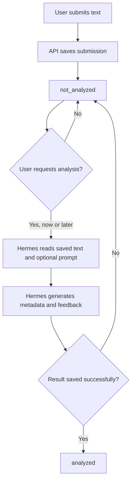

# Writing — Independent Submissions and Optional Analysis

> Date: 2026-10-03. Status: design proposal; not implemented.
> This document records the agreed product direction and proposed implementation for Writing.
> For future implementation, its agreed decisions supersede conflicting behavior in
> [the original Writing design](writing-feature-design.md). Existing endpoints, database
> migrations, and Hermes runtime instructions still describe the current implementation.

> Phases 1–2 update: [Writing submission contract](writing-submission-contract.md) now
> resolves the edit guard, code format, version checks, API contracts, and final schema
> migration. It takes precedence where this original proposal differs. Migration 0011
> is prepared only; the user will execute migrations.

## 1. Purpose and decision status

Writing must support both responses to a generated prompt and independent free writing.
Saving a user's text and analyzing it are separate actions. A submission can remain saved
without analysis for as long as the user wants.

### Agreed product direction

- Daily and by-request practice create a `writing_materials` record before the user writes.
- Free writing creates only a `writing_submissions` record, with no synthetic material.
- A material can have multiple submissions; each submission has its own public code.
- Save the original text first. Analyze only when the user explicitly requests it, either with the initial submission or later through a command or the **Analisis tulisan** CTA.
- AI estimates topic, genre, tags, and level from the actual text for every submission.
- All four `estimated_*` fields and `analysis` start as `null`.
- A prompt is guidance, not an acceptance condition. A response that does not follow it still receives full analysis and a short note about its fit with the prompt.
- Use `created_at` as the submission creation time. Remove the separate `submitted_at`.
- Remove `submission_number`. Use submission codes for references and `created_at` with `id` as a tie-breaker for ordering.

The user confirmed that analyzed text is locked while all four `estimated_*` fields
remain editable. The web analysis button remains inactive for this release; analysis
is available through direct Telegram commands only.

The finalized contract selects the implementation details for phases 1–2. Section 11
summarizes those decisions; the broader flow below remains the design context.

## 2. Concepts and ownership

| Concept | Meaning | Owner |
| --- | --- | --- |
| Settings | Persistent defaults for future generated prompts | User, persisted by API |
| Material | Instructions for a writing exercise | Generated by Hermes, persisted by API |
| Submission | A user's actual text, optionally linked to a material | User, persisted by API |
| Estimated metadata | Description of the text that was actually written | Initially AI; user may correct all estimated fields |
| Analysis | Structured feedback on a saved submission | Generated by Hermes, validated and persisted by API |
| Word count, codes, timestamps, status | Authoritative stored bookkeeping | Backend |

Hermes owns cron, Telegram interactions, prompt generation, and AI analysis. The API
remains passive: it validates requests, calculates word counts, manages transactions,
and persists results. The browser does not generate authoritative AI feedback.

No new scheduler, queue, model client, or worker inside the API is implied by this design.
Automatic web-to-Hermes analysis is deferred. The current release uses Telegram commands
and an inactive web analysis button.

## 3. Entry flows

| Mode | Trigger | Material | Submission |
| --- | --- | --- | --- |
| Daily writing | Hermes cron | Generated from current defaults; `source = cron` | Linked to that material |
| By request | User requests an exercise | Generated from requested criteria and remaining defaults; `source = request` | Linked to that material |
| Free writing | User supplies their own text | None | `material_id = null` |

### 3.1 Daily writing

1. Hermes reads Writing settings and selects a topic/genre, avoiding recent repetition
   where context permits.
2. Hermes generates and saves a material, then delivers the prompt and material code.
3. The user sends a response. Hermes resolves the intended material and saves a submission.
4. The backend preserves the text, calculates `word_count`, and returns a submission code
   with status `not_analyzed`.
5. If analysis was explicitly requested, Hermes analyzes that saved submission. Otherwise,
   it confirms the save and leaves analysis available for later.

### 3.2 By-request writing

1. The user requests an exercise, optionally specifying topic, genre, level, or length.
2. Hermes uses those one-off criteria and the remaining defaults to create a material.
   Persistent defaults change only through an explicit settings change.
3. Saving and analyzing the user's response follow steps 3–5 of daily writing.

An explicit one-off length may remain outside the default min/max range, as in the
original design.

### 3.3 Free writing

1. The user supplies a text without asking for a prompt or responding to a material.
2. Save it directly as a submission with `material_id = null`.
3. Return its submission code and `not_analyzed` status.
4. Analyze only if the user requests analysis now or later.

Do not automatically attach explicit free writing to the latest unanswered material.
For a response to a prompt, prefer an explicit material code or unambiguous conversation
context. Ask for the intended target if it cannot be resolved reliably.

## 4. Save and analysis lifecycle



The proposed persisted statuses are `not_analyzed` and `analyzed`. `not_analyzed` does
not mean an analysis job has been queued. The user may intentionally leave it that way.

“Save and analyze now” still performs two distinct writes: first save the text, then save
the analysis. A failure in the second step must not roll back or duplicate the submission.
Retry using the existing submission code.

A successful analysis writes all estimated metadata, `analysis`, `analyzed_at`, and
`analysis_status = analyzed` together in one transaction. Partial or invalid feedback
must not leave the submission looking analyzed. Do not hold a database transaction open
while Hermes generates feedback.

Use the `revision` / `expected_revision` contract to reject feedback generated from an
older text. Analyzed text is locked, but estimated metadata remains editable. Reanalysis
and automatic revision history are deferred; see the finalized contract for conflict rules.

## 5. Proposed database design

### 5.1 Existing settings and materials

Keep `writing_settings` and `writing_materials`. Their current columns remain useful for
prompt generation. Material `topic`, `genre`, `tags`, `level`, and `target_word_count`
describe the requested exercise; they must not be copied into submission estimates as
if they described the user's actual text.

The material's `source` continues to distinguish `cron` from `request`. Free writing is
identified by its null `material_id`; it does not need a material or a new material source.

### 5.2 `writing_submissions`

| Column | PostgreSQL type | Nullable | Default / meaning |
| --- | --- | --- | --- |
| `id` | `BIGSERIAL` | No | Internal primary key |
| `code` | `TEXT` | No | Unique public submission identifier; e.g. `WS-20261003-001` |
| `material_id` | `BIGINT` | Yes | FK to `writing_materials.id`; null for free writing |
| `original_text` | `TEXT` | No | Exact text supplied by the user |
| `word_count` | `INTEGER` | No | Backend-calculated word count |
| `analysis_status` | `TEXT` | No | Stored generated value from `analysis`: `not_analyzed` or `analyzed` |
| `estimated_topic` | `TEXT` | Yes | Default null; topic inferred from actual text |
| `estimated_genre` | `TEXT` | Yes | Default null; genre inferred from actual text |
| `estimated_tags` | `TEXT[]` | Yes | Default null; tags inferred from actual text |
| `estimated_level` | `TEXT` | Yes | Default null; estimated CEFR level |
| `analysis` | `JSONB` | Yes | Default null; structured feedback |
| `analyzed_at` | `TIMESTAMPTZ` | Yes | Set on successful analysis by the application |
| `revision` | `INTEGER` | No | Default 1; incremented explicitly by application updates |
| `created_at` | `TIMESTAMPTZ` | No | Default `NOW()`; submission creation time |
| `updated_at` | `TIMESTAMPTZ` | No | Default `NOW()`; last stored change |
| `deleted_at` | `TIMESTAMPTZ` | Yes | Default null; soft deletion |

Migration 0011 directly removes `submitted_at` and `submission_number` and requires
a non-null submission code. The application is unused and Writing data is empty.
No `is_locked` field is needed: the service rejects text edits when stored analysis exists.
There is no database guard function or update trigger. Application updates explicitly
increment `revision` and refresh `updated_at`.

### 5.3 Constraints and invariants

- `code` is unique across all submissions, including soft-deleted rows, and is not reused.
- `material_id` is nullable, with a foreign key when present. Validate that a referenced
  material is active when attaching a new submission.
- `word_count > 0`. Reject blank/whitespace-only text without trimming or otherwise
  rewriting the stored `original_text`.
- Generate `analysis_status` from the presence of `analysis`; clients cannot set it.
- `not_analyzed` requires SQL `NULL` for both `analysis` and `analyzed_at`. New successful
  analyses supply both through the application. The database requires both fields to be
  null or both present. If non-null, `analysis` must be a JSON object.
- Validate the complete nested feedback structure with Zod. A JSON object check alone
  does not establish that an analysis is valid.
- New successful analyses supply all four `estimated_*` fields. Keep them nullable for
  initial saves.
- `estimated_tags = null` means no metadata value is available; `[]` means an explicitly
  supplied empty tag list. At initial creation, all estimated fields are null.
- Metadata populated by a user does not itself imply analysis. Changing metadata must
  not silently change `analysis_status`.

### 5.4 Identity, ordering, and proposed indexes

Use submission codes for both free writing and responses to materials. Material codes
continue to identify prompts. The selected convention is `WS-YYYYMMDD-NNN`, based on Jakarta creation dates,
with a daily sequence that expands beyond three digits.

Order submission lists by `created_at DESC, id DESC` by default; reverse both for oldest
first. A displayed row number is presentation only, not a durable reference.

Proposed indexes:

- Unique index on `code`, including deleted rows.
- Active list index on `(created_at DESC, id DESC)` where `deleted_at IS NULL`.
- Active material list index on `(material_id, created_at DESC, id DESC)` where
  `deleted_at IS NULL AND material_id IS NOT NULL`.

Add indexes for status or metadata filtering only when the final query contract and
query plans justify them.

## 6. Metadata and feedback

The same estimated fields apply to every submission. An A1 prompt does not force
`estimated_level = A1`; the estimate describes the user's language ability in that text.
Genre/topic mismatch does not block saving, analysis, or corrected-text delivery.

Reuse the existing structured analysis sections, replacing separate `topic_adherence`
and `genre_adherence` with one concise `prompt_adherence` section:

| Analysis key | Content |
| --- | --- |
| `summary` | Overall feedback, strengths, priority improvements |
| `grammar` | Corrections and explanations |
| `corrected_text` | Full corrected version |
| `vocabulary` | Repeated words, better phrases, useful new words |
| `structure` | Organization/coherence feedback and suggestions |
| `prompt_adherence` | Short assessment against the linked prompt, or null for free writing |
| `next_steps` | Actionable practice or revision suggestions |

Example for a prompted submission:

```json
{
  "prompt_adherence": {
    "status": "not_aligned",
    "notes": "Tulisan membahas olahraga, sementara prompt meminta tema makanan."
  }
}
```

The proposed adherence values are `aligned`, `partially_aligned`, and `not_aligned`.
For free writing, the analyzed JSON contains `"prompt_adherence": null`. Before any
analysis, the entire `analysis` column is SQL `NULL`.

Topic/genre estimates remain top-level submission columns for discovery; they are not
duplicated inside the analysis JSON. Continue offering a concise feedback summary first
in Telegram and deliver the full corrected text on request.

## 7. Proposed API surface

All routes below are under `/api/v1/writing`. These are proposed contracts, not existing
endpoints. Use snake_case, Zod input validation, the existing response/error envelopes,
and the route → validator → handler → service → repository boundary.

| Method / path | Purpose | Status of proposal |
| --- | --- | --- |
| `GET/PATCH /settings` | Read/update prompt defaults | Keep existing responsibility |
| `POST /materials` | Save a Hermes-generated prompt | Keep existing responsibility |
| `GET /materials` | Discover prompts | Adjust submission/analysis summary semantics |
| `GET /materials/:code` | Read prompt details | Keep material identity |
| `POST /submissions` | Save text with optional `material_code` | New unified save contract |
| `GET /submissions` | Discover saved text, including free writing | New collection contract |
| `GET /submissions/:code` | Read text, metadata, status, and available feedback | New independent reference |
| `PATCH /submissions/:code` | Edit permitted user fields | Text before analysis; metadata remains editable |
| `PATCH /submissions/:code/analysis` | Persist complete Hermes-generated feedback and metadata | Separate from requesting generation |
| `GET /submissions/:code/corrected-text` | Read stored corrected text | Available only after analysis |

Example save request for free writing:

```json
{
  "material_code": null,
  "original_text": "I played football with my friends yesterday."
}
```

For prompted writing, provide a material code such as `WR-20261003-001`. Omission of
`material_code` means free writing as well. The API must not choose a
material implicitly. Saving does not require estimates or analysis from the caller.

The proposed analysis write accepts all four `estimated_*` fields and the complete
`analysis` object. The backend sets status and timestamps; callers do not set those
bookkeeping fields directly. This endpoint stores generated results; it does not invoke AI.

The submission collection supports filtering by material, writing type, and analysis
status, with pagination and stable date ordering. Exact query names and search fields
are specified in the finalized contract.

**Analysis requests for this release use Telegram only.** Keep the web analysis button
inactive; it does not start or queue work. The result-write endpoint remains separate
from generation and accepts authenticated Agent writes only. Exact contracts and safe
errors are defined in the finalized Writing submission contract.

## 8. Frontend and Telegram behavior

- Provide an entry point for free writing without selecting or generating a material.
- Separate saving from requesting analysis. The initial save must work without AI output.
- Submission detail shows its code, text, creation time, and analysis status. Unavailable
  estimates are displayed as unavailable, not inferred from the material.
- Show an inactive **Analisis tulisan** button for unanalyzed submissions, with clear
  Telegram-only availability. In Telegram, immediate analysis still saves the text first.
- A material detail lists all its active submissions, ordered by `created_at` and `id`,
  with their own codes and analysis statuses. Navigation uses submission codes.
- A material with one saved submission is no longer necessarily reviewed. Derive saved
  and analyzed counts separately; a mix of analyzed and unanalyzed submissions must
  remain visible. The contract defines `unsubmitted`, `submitted`, and `reviewed`.
- Preserve the user's text when saving or requesting analysis fails. After a successful
  save, offer analysis retry on that same code rather than resubmitting the text.
- Show feedback only when it exists. Keep corrected text behind a clear local action.
- Lock original text after analysis and keep estimated metadata editable. Implement the
  backend guard as well as the corresponding frontend controls.

## 9. Scenarios and acceptance examples

| Scenario | Expected behavior |
| --- | --- |
| Daily prompt, response saved without analysis | Material linked; text saved; all estimates and analysis null; `not_analyzed` |
| By-request prompt with custom length | Material records requested criteria; persistent defaults unchanged |
| Free writing while unanswered prompts exist | Save without a material when the user's free-writing intent is clear |
| Ambiguous response target | Resolve the intended material/free-writing context before saving |
| “Save and analyze now” | Save first, analyze the returned submission, then persist feedback |
| User requests analysis days later | Read the existing saved text and optional prompt; update that same submission |
| AI generation or result persistence fails | Keep the saved submission `not_analyzed`; allow retry using its code |
| Food prompt, sports response | Save normally; estimate sports topic; record concise prompt mismatch feedback |
| Free writing analyzed successfully | Fill estimated fields; `prompt_adherence = null`; set `analyzed` and `analyzed_at` |
| Multiple responses to one material | Separate submission codes; same material FK; no durable attempt number |
| Two submissions have the same creation time | Use `id` to keep ordering deterministic |
| User edits metadata manually | Do not mark the submission analyzed merely because metadata is populated |
| Text changes while feedback is being generated | Reject stale feedback using the expected revision |
| User tries editing after analysis | Reject text edits; permit corrections to estimated metadata |

## 10. Migration and delivery plan

The application has not been used and Writing data is empty. Migration 0011 directly
prepares the final schema without backfill or existing-row updates. Do not rewrite applied
migration 0006. The user executes migrations manually.

1. Add required independent submission codes, nullable material links, estimated metadata,
   analysis status, and analysis time. Relax non-null requirements on `estimated_level`
   and `analysis` to allow saving first.
2. Remove `submission_number`, `submitted_at`, and their dependent number constraint/index
   in migration 0011. There are no old writer adapters, null-code exceptions, historical
   link mappings, or later schema cleanup migrations.
3. Implement separate save/read/result-write workflows against this schema. Services
   enforce text locking, code immutability, and rejection of repeated analysis. Repository
   updates explicitly increment revision and refresh `updated_at`.
4. Update Hermes and frontend routes/navigation to submission codes. Keep analysis
   Telegram-only and the web analysis button inactive for this release.

Verification of the later application implementation should cover independent saves,
optional analysis, atomic feedback persistence, exact text preservation, incorrect material
references, ordering, failure/retry behavior, stale results, and edit guards. Schema
verification covers required codes, removed columns, new fields, constraints, indexes,
and empty-table rollback.

## 11. Decision resolution for phases 1–2

The [finalized contract](writing-submission-contract.md) provides exact rules and safe
errors for the selected release scope.

| Topic | Resolution |
| --- | --- |
| Post-analysis locking | Enforced in application code; text and derived word count lock, prompt association is creation-only, estimated metadata stays editable. |
| Editing before analysis | Text and metadata may be edited; first AI result fills null estimates and preserves manually supplied values. |
| Reanalysis and revisions | Deferred; existing feedback cannot be silently replaced through the new API. |
| In-progress concurrency | Revision checks and short service-owned row-locking transactions; no database transaction during AI generation. |
| Web analysis CTA | Inactive button for now; direct Telegram analysis commands only. |
| Analysis write authorization | Agent-only result writes; browser JWT alone does not authorize AI feedback writes. |
| Submission code convention | `WS-YYYYMMDD-NNN`, Jakarta creation date, daily sequence including deleted rows. |
| Material summaries | Saved and analyzed counts separately; `unsubmitted`, `submitted`, or `reviewed` as defined in the contract. |
| Migration scope | Unused application and empty Writing data; prepare the final schema directly, removing obsolete columns and requiring codes. No compatibility phase. |
| Override semantics | Existing level/length calculation is retained for this release. Broader topic/genre semantics remain outside phases 1–2. |
